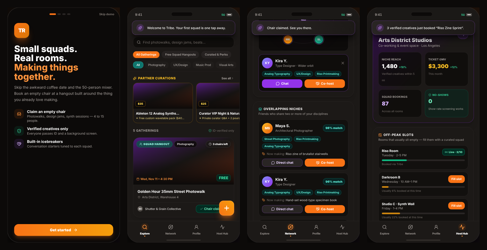
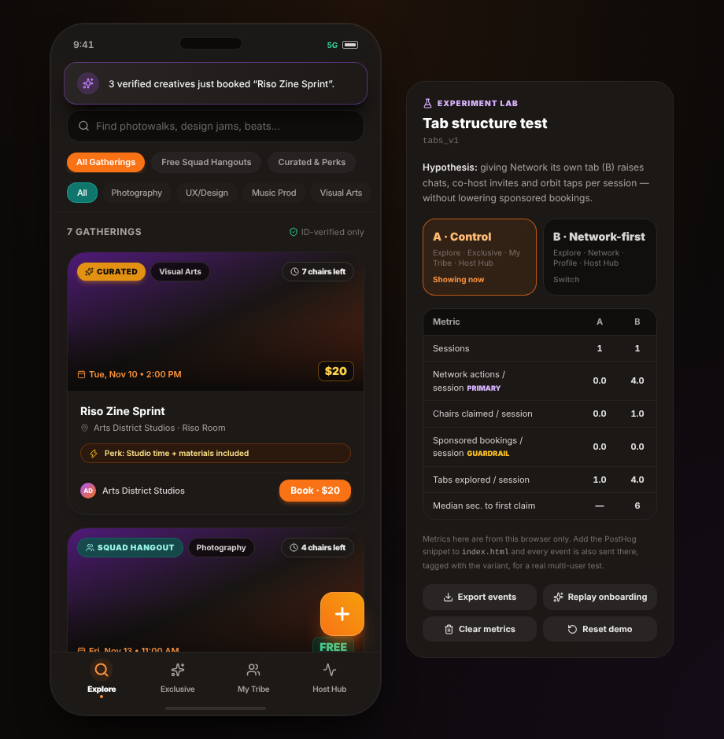

# Tribe — small squads, real rooms

**OpenTable meets Meetup for high-intent groups.** Tribe lets adults skip the awkward 1:1 coffee and the 50-person mixer: you book an *empty chair* in a small, activity-first gathering — a photowalk, a design jam, a synth session — with verified people who make the same kinds of things you do.

This repo is an interactive **mobile prototype** (React + Tailwind) for the creative-community beachhead: designers, street photographers, music producers, visual artists and writers.



> **Live demo:** `https://<your-username>.github.io/<repo-name>/` once GitHub Pages is on (see [Deploy](#deploy)).
> Add `?variant=a` or `?variant=b` to the URL to force a tab layout, and `?lab=1` to open the Experiment Lab on a phone.

---

## What's in the MVP

| Pillar | What you can do in the prototype |
| --- | --- |
| **Onboarding & trust** | Pick your creative niches, run a (simulated) ID + selfie + background check, and take the Show-Up Pledge. Unverified users can't claim chairs. |
| **Explore** | Filter by niche and by free Squad Hangouts vs. Curated sponsor events. Search, claim a chair in one tap, and read Squad Icebreakers before you go. Host your own hangout from the `+` button. |
| **Network** | A radial **Orbit** of the people you actually make things with — closeness shown spatially, never as a number. **Overlapping Niches** surfaces friends who share 2+ disciplines, what they're making now, and one-tap **Direct Chat** or **Co-host**. |
| **Post-hangout feedback** | Mark who showed up (feeds Show Rate), leave up to 3 anonymous, positive-only vibe tags per person, then unlock what your squad said about *you* — double-blind, so nobody tit-for-tats. |
| **Profile** | Verification status, Jams Joined, Show Rate, the **Verified Vibe Cloud**, niche tags, and reserved chairs with release toggles (late releases are flagged). |
| **Host Hub (B2B)** | A venue fills **off-peak slots** with curated, ticketed squads, optionally led by a Top Niche Connector. Event Genie drafts concepts; GMV and bookings update as the slot fills. Zero no-shows, thanks to Show Rate screening. |

All data is fictional and lives in your browser (localStorage). Avatars are generated initials — no real people are shown as users.

## A/B test: tab structure

The prototype ships two navigation layouts and splits visitors 50/50 (sticky per browser).

| | Tabs | Idea |
| --- | --- | --- |
| **A · Control** | Explore · Exclusive · My Tribe · Host Hub | Sponsored events get their own tab; profile and network share one. |
| **B · Network-first** | Explore · Network · Profile · Host Hub | Network gets a dedicated tab; sponsored events move to a rail + filter in Explore. |

**Hypothesis:** B increases *network actions per session* (chats, co-host invites, orbit taps) **without** lowering *sponsored bookings per session* (guardrail).



The **Experiment Lab** (beside the phone on wide screens; tap the `9:41` clock on a phone) lets you switch arms, see per-variant metrics, export the raw event log, replay onboarding, and reset the demo.

**Running it with real users:** the Lab only sees your own browser. Paste the [PostHog](https://posthog.com) snippet into `index.html` and every tracked event is also sent there, tagged with the variant (`src/lib/analytics.js`). Tracked events: `session_start`, `tab_view`, `event_open`, `rsvp`, `rsvp_release`, `orbit_open`, `chat_open`, `chat_send`, `cohost_sent`, `feedback_submitted`, `event_created`, `host_publish`, `onboarding_complete`.

## Run it locally

Requires Node 20+.

```bash
npm install
npm run dev      # http://localhost:5173
npm run build    # production build in dist/
```

## Deploy

1. Push this repo to GitHub (default branch `main`).
2. In the repo, go to **Settings → Pages** and set **Source** to **GitHub Actions**.
3. The workflow in `.github/workflows/deploy.yml` builds and publishes on every push to `main`.

## Project structure

```
src/
  App.jsx                 phone shell, tab routing, overlay host
  state/TribeContext.jsx  reducer, persistence, variant + navigation, booking logic
  lib/
    experiment.js         A/B variant definitions and assignment
    analytics.js          event tracking, per-variant summaries, export
    time.js               dates relative to today, pickers
    storage.js            guarded localStorage
  data/                   seed people, events, icebreakers, vibes, host slots
  components/             UI primitives, event cards, nav/status bar, Experiment Lab
  views/                  Explore, Exclusive, Network, Profile, My Tribe, Host Hub
  sheets/                 event detail, create, onboarding, feedback, chat, co-host, publish slot
```

## Design system

Dark, glassy stone surfaces (`stone-950/900`, `border-stone-800`, `backdrop-blur`) with role-based color:

- **Orange** — primary actions and active states
- **Teal** — community badges and niche tags
- **Purple** — connection, verification flow, icebreakers, host metrics
- **Amber** — sponsored perks
- **Emerald** — verified and reliable

Headings use Bricolage Grotesque; body uses Inter.

**Design rule:** the network never shows Dunbar-style counters or capacity limits — closeness is spatial and organic.

## Roadmap ideas

- Real auth + verification provider (e.g. Persona, Stripe Identity)
- Waitlists and auto-fill when a chair is released
- Payments for curated tickets
- Host-side calendar sync for off-peak slots
- Accessibility pass with real screen-reader testing

## Credits

Event cover photos are loaded from [Unsplash](https://unsplash.com). Icons by [Lucide](https://lucide.dev).
